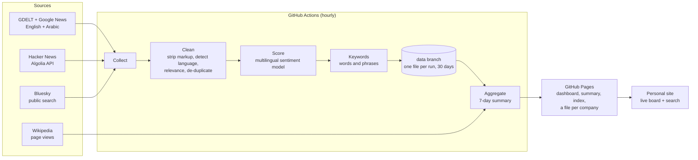

# Architecture

Murmur is a batch pipeline that runs once an hour on GitHub Actions. There is no server: the
output is a static site and a set of JSON files on GitHub Pages.

## Which companies each run collects

Murmur follows the companies in `companies.toml` (137 at the moment). Featured companies are
collected every run. Of the rest, each run takes the quarter that were collected longest ago, so every
company comes round in about four runs while a run stays short and polite to each source.
`collected.json` on the data branch records when each company was last collected, and each search
looks back to that moment plus an hour (at least 6 hours, at most 48). GitHub runs schedules on a
best-effort basis and sometimes skips hours, so nothing assumes the job really runs hourly. The
published files are always rebuilt from storage for every company, not only the ones just collected.

If a source keeps rate limiting (GDELT often does on shared cloud IPs), it is skipped for the rest
of that run and picked up again next hour.



## Stages

| Stage | Module | What it does |
| --- | --- | --- |
| Collect | `sources/*` | One collector per source. Each returns `RawItem`s and never raises: a failing source is logged and skipped. |
| Clean | `clean.py`, `text.py` | Strips HTML and links, detects English or Arabic by script, keeps posts that mention a company alias (news already comes from phrase searches), drops spam and per-company exclusions, and removes duplicates by id and by text. |
| Score | `sentiment.py` | `model` backend: a multilingual DistilBERT that labels English and Arabic text positive, neutral or negative. `lexicon` backend: VADER, English only, used in tests and as a fallback. |
| Keywords | `keywords.py` | Single words plus two-word phrases, with English and Arabic stop words removed. Ranked by how many mentions use them. |
| Store | `store.py` | Gzipped JSON Lines on the `data` branch, one folder per day and one small file per run, kept for 30 days. Each commit only adds new data, and a weekly job (`squash-data.yml`) replaces the branch history with a single commit. |
| Aggregate | `aggregate.py` | Builds one summary per company (totals, per-day and per-hour counts, sentiment shares, top terms per language, latest headlines and Wikipedia page views), then the published files below. |
| Publish | `pipeline.py` | Copies `site/` and writes the JSON files into `public/`, which the workflow deploys to Pages. |

## Published files

| File | What it holds |
| --- | --- |
| `summary.json` | The featured companies, everything the front page needs in one request. |
| `index.json` | Every company's id, name, sector, other names (`known_as`), colour and weekly mention count. Small enough to search as you type. |
| `companies/<id>.json` | One company's full summary (the same shape as an entry in `summary.json`) under `company`, fetched when someone looks it up. |

## summary.json

`companies/<id>.json` uses the same envelope with a single `company` instead of `companies`.

```jsonc
{
  "version": 1,
  "generated_at": "2026-11-12T15:17:00+00:00",
  "window_days": 7,
  "sentiment_backend": "model",
  "sources": [{ "id": "news", "label": "News (GDELT)", "url": "…" }],
  "companies": [
    {
      "id": "tesla", "name": "Tesla", "color": "#E31937",
      "totals": { "mentions": 812, "by_source": { "news": 300, "hn": 120, "bluesky": 392 }, "by_lang": { "en": 760, "ar": 40, "other": 12 } },
      "sentiment": { "positive": 0.31, "neutral": 0.44, "negative": 0.25, "scored": 800, "net": 0.06 },
      "daily": [{ "date": "2026-11-06", "mentions": 110, "en": 100, "ar": 8, "other": 2, "positive": 30, "neutral": 50, "negative": 28, "pageviews": 2799 }],
      "hourly": [{ "hour": "2026-11-10T16:00:00+00:00", "mentions": 4 }],
      "top_terms": { "en": [{ "term": "battery range", "count": 12 }], "ar": [] },
      "headlines": [{ "title": "…", "url": "…", "domain": "…", "lang": "en", "published_at": "…", "sentiment": "neutral" }]
    }
  ]
}
```

The schema is versioned; consumers should check `version`.

## Cost

Everything runs on free tiers: GitHub Actions minutes are free for public repositories, GitHub
Pages hosting is free, and every data source is free and keyless. The sentiment model runs on the
Actions runner's CPU, so there is no paid inference.
