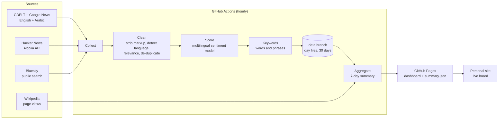

# Architecture

Murmur is a batch pipeline that runs once an hour on GitHub Actions. There is no server: the
output is a static site and one JSON file on GitHub Pages.



## Stages

| Stage | Module | What it does |
| --- | --- | --- |
| Collect | `sources/*` | One collector per source. Each returns `RawItem`s and never raises: a failing source is logged and skipped. |
| Clean | `clean.py`, `text.py` | Strips HTML and links, detects English or Arabic by script, keeps posts that mention a company alias (news already comes from phrase searches), drops spam and per-company exclusions, and removes duplicates by id and by text. |
| Score | `sentiment.py` | `model` backend: a multilingual DistilBERT that labels English and Arabic text positive, neutral or negative. `lexicon` backend: VADER, English only, used in tests and as a fallback. |
| Keywords | `keywords.py` | Single words plus two-word phrases, with English and Arabic stop words removed. Ranked by how many mentions use them. |
| Store | `store.py` | One gzipped JSON Lines file per day on the `data` branch, kept for 30 days. Files are written deterministically so unchanged days don't create git diffs. |
| Aggregate | `aggregate.py` | Builds `summary.json`: totals, per-day and per-hour counts, sentiment shares, top terms per language, latest headlines and Wikipedia page views. |
| Publish | `pipeline.py` | Copies `site/` and writes `summary.json` into `public/`, which the workflow deploys to Pages. |

## summary.json

```jsonc
{
  "version": 1,
  "generated_at": "2026-11-12T15:17:00+00:00",
  "window_days": 7,
  "sentiment_backend": "model",
  "sources": [{ "id": "news", "label": "News (GDELT)", "url": "…" }],
  "companies": [
    {
      "id": "tesla", "name": "Tesla", "color": "#E31937",
      "totals": { "mentions": 812, "by_source": { "news": 300, "hn": 120, "bluesky": 392 }, "by_lang": { "en": 760, "ar": 40, "other": 12 } },
      "sentiment": { "positive": 0.31, "neutral": 0.44, "negative": 0.25, "scored": 800, "net": 0.06 },
      "daily": [{ "date": "2026-11-06", "mentions": 110, "en": 100, "ar": 8, "other": 2, "positive": 30, "neutral": 50, "negative": 28, "pageviews": 2799 }],
      "hourly": [{ "hour": "2026-11-10T16:00:00+00:00", "mentions": 4 }],
      "top_terms": { "en": [{ "term": "battery range", "count": 12 }], "ar": [] },
      "headlines": [{ "title": "…", "url": "…", "domain": "…", "lang": "en", "published_at": "…", "sentiment": "neutral" }]
    }
  ]
}
```

The schema is versioned; consumers should check `version`.

## Cost

Everything runs on free tiers: GitHub Actions minutes are free for public repositories, GitHub
Pages hosting is free, and every data source is free and keyless. The sentiment model runs on the
Actions runner's CPU, so there is no paid inference.
